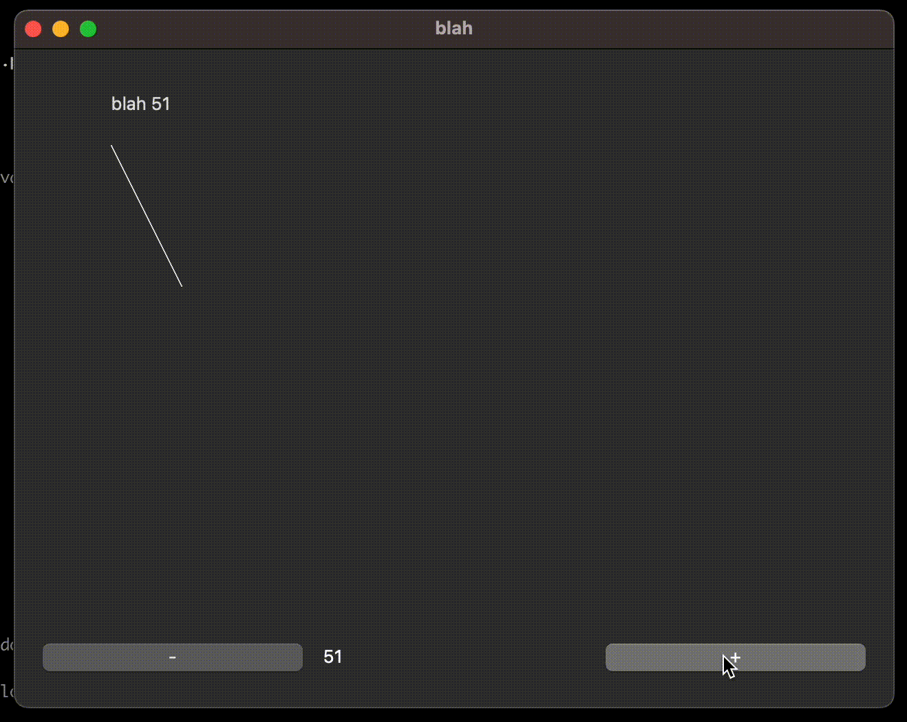

# What is PUI
PUI is a reactive/declarative UI framework with two-way data binding.
PUI doesn't do UI itself, it turns imperative UI libraries into reactive/declarative flavor with virtual DOM and aims to maintain interoperability.

[Slides for SciWork 2023](https://speakerdeck.com/buganini/pui-declarative-ui-framework-for-python)

[CPPUI: Experimental C++ Version](https://github.com/buganini/CPPUI)

# Features
* [Declarative UI](REFERENCE.md#declarative-components)
* [Reactive state with two-way binding](#state--data-binding)
* [Hot Reloading](#hot-reload)
* [Multiple Backends](#backends)

# Installation

Choose a backend extra:

```shell
pip install 'QPUIQ[pyside6]'
pip install 'QPUIQ[wx]'
pip install 'QPUIQ[flet]'
pip install 'QPUIQ[textual]'
```

The flet extra installs the current Flet 1.x desktop/web runtime (minimum tested
version: 1.0.4). Table support uses its built-in DataTable, including Dropdown
choices and dialog editing; no table extension is required.

For tkinter, install `QPUIQ` and use a Python build with Tk support:

```shell
pip install QPUIQ
python -c "import tkinter"
```

The optional `QPUIQ[tkinter]` spelling installs the same packages; its extra is
empty because Tk is supplied by Python or the operating system.
Some Linux distributions provide Tk support separately as
`python3-tk`; an existing virtual environment uses its base Python's native
support. wxPython can also require platform-native GTK/build dependencies.

For the framework alone, install `QPUIQ`. Optional development tools:

```shell
pip install jurigged  # Hot reload
pip install pygments # Cookbook syntax highlighting
```

When working from this checkout, use the project environment:

```shell
python3 -m venv env
env/bin/python -m pip install -e '.[pyside6,flet,textual]'
# Add .[wx] when wxPython is available for the platform.
```

Backend alignment and checked runtime versions are tracked in
[wx progress](doc/wx-progress.md), [flet progress](doc/flet-progress.md),
[tkinter progress](doc/tkinter-progress.md), and
[Textual plan](doc/textual-progress.md).

# Get Started
## Hello World
```python
# example/hello_world.py
from PUI.PySide6 import *

@PUIApp
def Example():
    with Window(title="test", size=(320,240)):
        Label("Hello world")

root = Example()
root.run()
```


## State & Data Binding
```python
# example/generic_textfield.py
from PUI.PySide6 import *

data = State()
class Example(Application):
    def __init__(self):
        super().__init__()
        data.var = 0

    def content(self):
        with Window(title="blah"):
            with VBox():
                with HBox():
                    Button("-").click(self.on_minus)
                    Label(f"{data.var}")
                    Button("+").click(self.on_plus)

                TextField(data("var")) # binding

    def on_minus(self):
        data.var -= 1

    def on_plus(self):
        data.var += 1

root = Example()
root.run()
```


## View Component
```python
# example/bleak_list.py

....

@PUI # View Component
def DeviceView(device, advertising_data):
    Label(f"{device.address} {device.name} {advertising_data.rssi}")

class GUI(Application):
    def __init__(self, state):
        super().__init__()
        self.state = state

    def content(self):
        with Window(title="BLE List"):
            with VBox():
                Label(f"Found {len(self.state.scanned_devices)} devices")
                for device, advertising_data in self.state.scanned_devices:
                    DeviceView(device, advertising_data)

....
```


## Layout & Styling
```python
# example/pyside6_feedparser.py

...
with VBox():
    Label(title).qt(StyleSheet={"font-weight":"bold"}) # QT-specific

    with HBox():
        with Scroll():
            with VBox():
                for i,e in enumerate(entries):
                    Label(e.title).click(self.entry_selected, i)
                Spacer()

        with Scroll().layout(weight=1): # Generic Layout Parameter
            if 0 <= selected and selected < len(entries):
                (Text(entries[selected].description)
                    .layout(padding=10) # Generic Layout Parameter
                    .qt(StyleSheet={"background-color":"white", "color":"black"})) # QT-specific
...
```


## Canvas
```python
# example/generic_canvas.py

from PUI.PySide6 import *

data = State()
class Example(Application):
    def __init__(self):
        super().__init__()
        data.var = 50

    def content(self):
        with Window(title="blah", size=(640,480)):
            with VBox():
                Canvas(self.painter, data.var)
                with HBox():
                    Button("-").click(self.on_minus)
                    Label(f"{data.var}").layout(weight=1)
                    Button("+").click(self.on_plus)

    @staticmethod
    def painter(canvas, var):
        # Canvas coordinates are logical pixels. Use pixel_density when
        # preparing raster images for HiDPI displays.
        raster_scale = canvas.pixel_density
        canvas.drawText(var, var/2, f"blah {var}")
        canvas.drawLine(var, var, var*2, var*3, color=0xFFFF00)

    def on_minus(self):
        data.var -= 1

    def on_plus(self):
        data.var += 1

root = Example()
root.run()
```

`canvas.pixel_density` is the number of physical display pixels per logical
canvas pixel. It is updated before each paint where the backend exposes the
display scale, so moving a window between displays is handled automatically.
Canvas coordinates remain in logical pixels; multiply raster image resolution
by `pixel_density` when generating HiDPI content. Backends that cannot report a
display scale use `1.0`.



## Cookbook
`python -m cookbook PySide6` (requires pygments for syntax highlight)


`python -m cookbook textual`


`python -m cookbook flet`


`python -m cookbook tkinter`


# Hot Reload
``` shell
pip install jurigged
```
Then PUI will take care of view update [(code)](https://github.com/buganini/PUI/blob/main/PUI/__init__.py#L11)


# Backends
## Tier-1
* PySide6
## Lower Priority
* wx
* tkinter
    * or https://github.com/rdbende/Sun-Valley-ttk-theme
* flet
* textual (Text Mode)
    * no canvas

# Documents
* [Components Reference](https://buganini.github.io/PUI/doc/Reference.html)
* [Layout Strategy](https://buganini.github.io/PUI/doc/Layout.html)

# Used by
* https://github.com/buganini/Kikakuka
* https://github.com/solvcon/modmesh

# TODO
* Dump with layout parameters and add test cases
* [Toga](https://beeware.org/project/projects/libraries/toga/)
* [ISSUE] flet layout sizing (cookbook scroll example)
* nested state trigger
    * set state in PUIView __init__
    * set state in setup() ?
* Tabs(`tabposition`)
* Lazy List
* UI Flow
    * Navigation Stack
    * View Router
    * Model Window/Dialog
* Layout
    * SwiftUI style overlay ??
* Canvas
    * Arc
    * ...
* State with Pydantic support?
