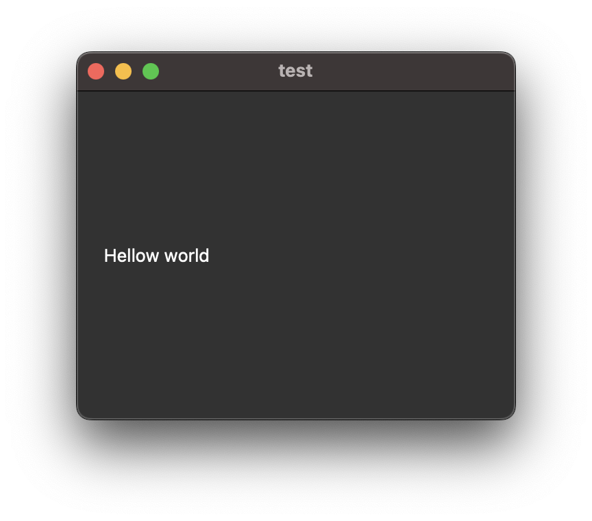
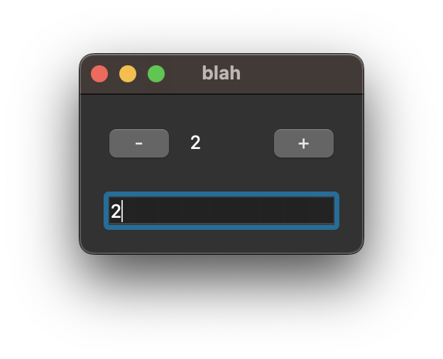
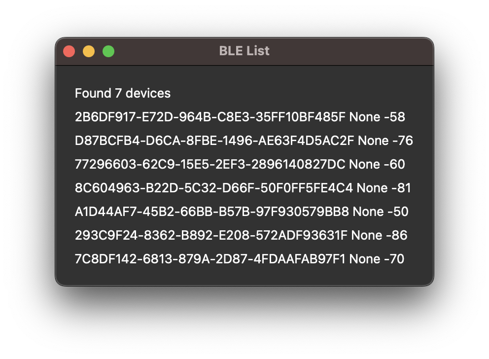
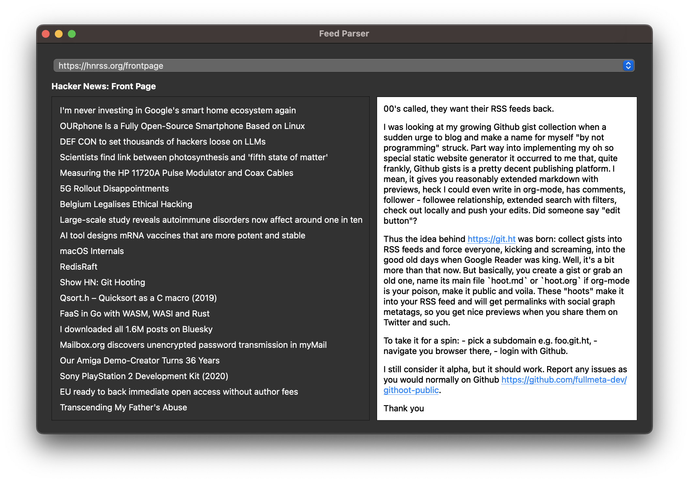
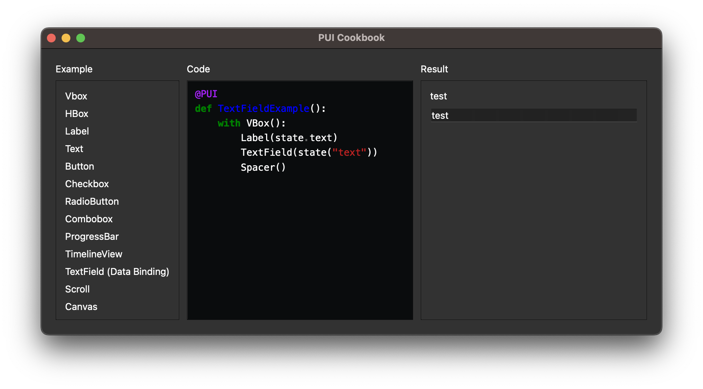
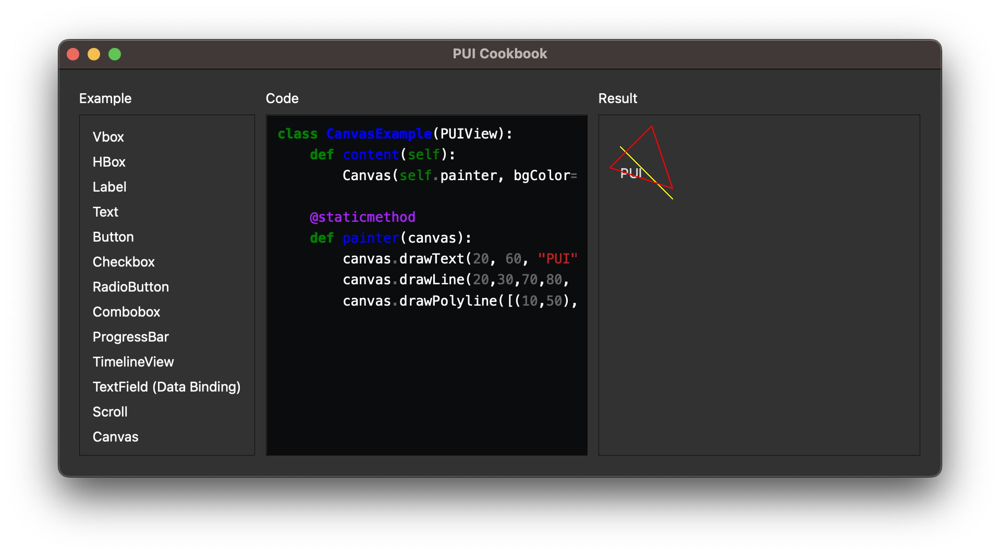
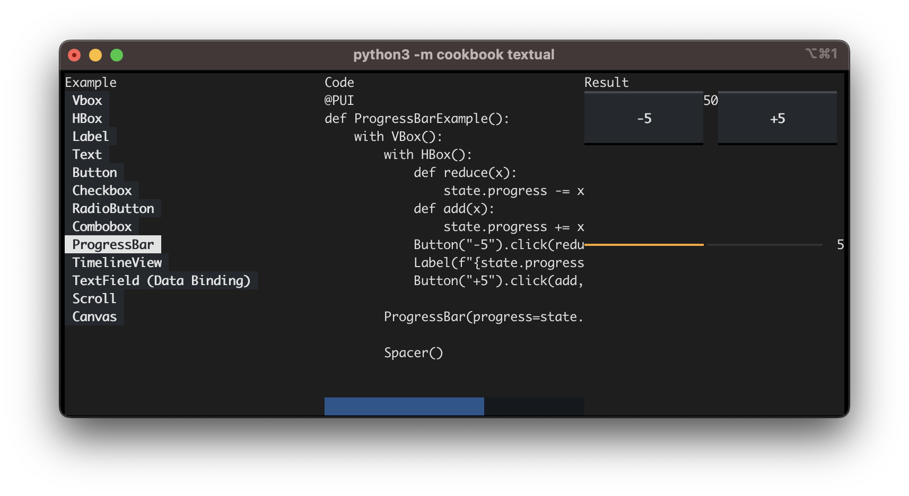
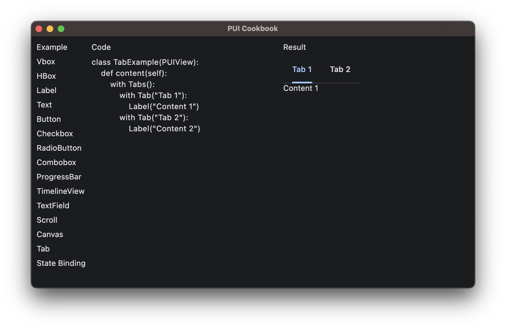
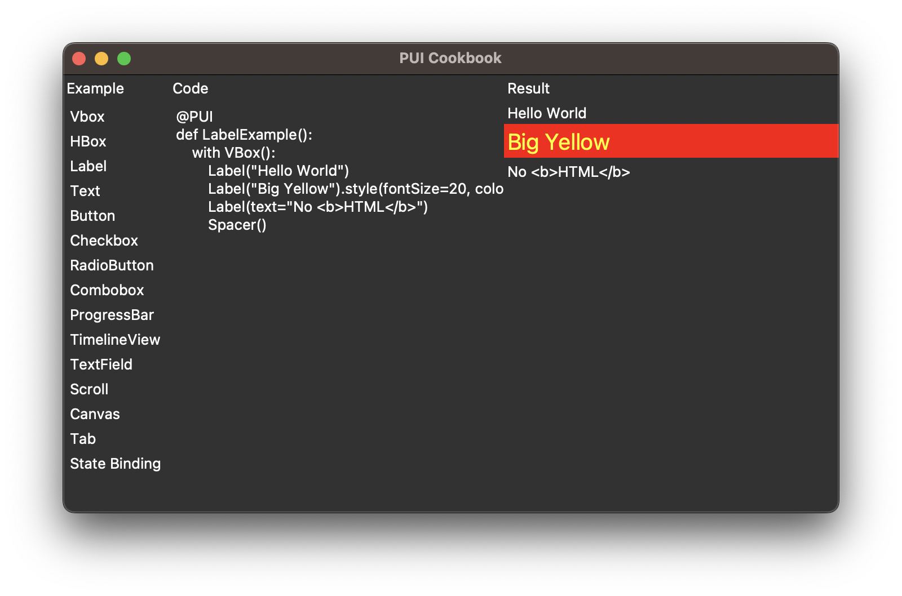

# What is PUI
PUI is a reactive/declarative UI framework with two-way data binding.
PUI doesn't do UI itself, it turns imperative UI libraries into reactive/declarative flavor with virtual DOM and aims to maintain interoperability.

[Slides for SciWork 2023](https://speakerdeck.com/buganini/pui-declarative-ui-framework-for-python)

[CPPUI: Experimental C++ Version](https://github.com/buganini/CPPUI)

# Features
* [Declarative UI](doc/Reference.html#declarative-components)
* [Reactive state with two-way binding](#state--data-binding)
* [Hot Reloading](#hot-reload)
* [Multiple Backends](#backends)

# Installation

PUI requires Python 3.9 or newer. Backend packages have their own Python and
platform requirements; the versions available for your interpreter may differ.
The shared framework and PySide6 backend retain Python 3.9 support. Shared changes
must preserve that baseline even when an optional backend requires newer Python.

Choose a backend extra:

```shell
pip install 'QPUIQ[pyside6]'
pip install 'QPUIQ[wx]'
pip install 'QPUIQ[flet]'
pip install 'QPUIQ[textual]'
pip install 'QPUIQ[web]'
```

The `web` extra installs aiohttp, msgpack and zstandard with their dependencies.
Browser JavaScript, CSS and zstd WASM are bundled in the package; no separate npm
install is needed to run the backend.

Install the development/cookbook dependencies with:

```shell
pip install 'QPUIQ[dev]'      # Pygments, Matplotlib and Shapely
pip install 'QPUIQ[web,dev]'  # Web backend plus cookbook dependencies
```

The `dev` extra can be combined with any backend extra. Pip selects dependency
versions compatible with the current Python interpreter, including Python 3.9.

The flet extra installs the current Flet 1.x desktop/web runtime (minimum tested
version: 1.0.4, requiring Python 3.10 or newer). Table support uses its built-in
DataTable, including Dropdown choices and dialog editing; no table extension
is required.

For tkinter, install `QPUIQ` and use a Python build with Tk support:

```shell
pip install QPUIQ
python -c "import tkinter"
```

The optional `QPUIQ[tkinter]` spelling installs the same packages; its extra is
empty because Tk is supplied by Python or the operating system.
Some Linux distributions provide Tk support separately as
`python3-tk`; an existing virtual environment uses its base Python's native
support. wxPython can also require platform-native GTK/build dependencies.

For the framework alone, install `QPUIQ`. Optional development tools:

```shell
pip install 'QPUIQ[reload]'  # Hot reload via jurigged
pip install textual-dev # Textual development tools
```

When working from this checkout, use the project environment:

```shell
python3 -m venv env
env/bin/python -m pip install -e '.[pyside6,flet,textual,dev]'
# Add .[wx] when wxPython is available for the platform.
# Add reload to enable hot reload, e.g. -e '.[web,dev,reload]'.
```

## Python 3.9 compatibility

The shared and Qt regression suites pass on Python 3.9.24 with PySide6 6.7.2 on
Linux. This covers state/bindings, lifecycle, signatures and legacy decorators,
plus Qt windows, controls, tables, trees, scrolling, Tabs, and Views. It does not
validate integration with an application's embedded interpreter or other platforms.
[PySide6 6.7.2 supports Python 3.9–3.12](https://pypi.org/project/PySide6/6.7.2/).
To use this tested combination on Python 3.9:

```shell
python3.9 -m pip install 'QPUIQ[pyside6]' 'PySide6==6.7.2'
```

To reproduce the compatibility check from a checkout, create a separate runtime
under `env/` and install only the packages needed for this baseline:

```shell
python3.9 -m venv env/python39
env/python39/bin/python -m pip install -e . -r tests/requirements-python39.txt
make check-python39
# Or use an existing environment: make check-python39 PYTHON39=/path/to/python3.9
```

The test runtime is pinned to `PySide6==6.7.2` in
[tests/requirements-python39.txt](tests/requirements-python39.txt), and
`make check-python39` rejects a different PySide6 version. The check runs the
shared and Qt regression suites; the Flet-specific signature test is skipped in
this environment.
The normal backend extra continues to allow newer versions. Run this check when changing
shared code or the Qt backend. Keep Python 3.10-only syntax and APIs, including
standard-library `ParamSpec`, out of code used by the Python 3.9 baseline.

# Get Started

Define applications by subclassing the backend's `Application`, and reusable
views by subclassing its `PUIView`. Put UI declarations in `content()`, initialize
local state in `setup()`, and use member functions as event handlers. Classes
are the recommended API; `@PUI` and `@PUIApp` are deprecated and retained for
compatibility. See the [migration reference](doc/Reference.html#deprecated-decorators).

Every backend accepts the keyword-only `Application(title="My app")`, defaulting
to `title=''`. Web uses it as the page title; Textual sets its app title and sends
the terminal title when mounted. PySide6/wx set the native application display
name; PySide6, wx, Tkinter and Flet also use it for windows without an explicit
`Window.title`. See [Application](doc/Reference.html#application) for title precedence
and terminal behavior.

## Hello World
```python
# example/hello_world.py
from PUI.PySide6 import *

class Example(Application):
    def content(self):
        with Window(title="test", size=(320,240)):
            Label("Hello world")

root = Example()
root.run()
```


## State & Data Binding
```python
# example/generic_textfield.py
from PUI.PySide6 import *

data = State()
class Example(Application):
    def __init__(self):
        super().__init__()
        data.var = 0

    def content(self):
        with Window(title="blah"):
            with VBox():
                with HBox():
                    Button("-").click(self.on_minus)
                    Label(f"{data.var}")
                    Button("+").click(self.on_plus)

                TextField(data("var")) # binding

    def on_minus(self, event):
        data.var -= 1

    def on_plus(self, event):
        data.var += 1

root = Example()
root.run()
```


## View Component
```python
# example/bleak_list.py

....

class DeviceView(PUIView):
    def __init__(self, device, advertising_data):
        super().__init__()
        self.device = device
        self.advertising_data = advertising_data

    def content(self):
        Label(f"{self.device.address} {self.device.name} {self.advertising_data.rssi}")

class GUI(Application):
    def __init__(self, state):
        super().__init__()
        self.state = state

    def content(self):
        with Window(title="BLE List"):
            with VBox():
                Label(f"Found {len(self.state.scanned_devices)} devices")
                for device, advertising_data in self.state.scanned_devices:
                    DeviceView(device, advertising_data)

....
```


## Layout & Styling

PUI handles normal widget sizing automatically. Each component supplies a
preferred size and expansion policy appropriate to the widget and its position
in an `HBox` or `VBox`; for example, a `TextField` uses the available horizontal
space while retaining its native height, and a `Spacer` consumes flexible space.
Application code normally does not need to assign control dimensions just to
make a layout fit.

Use `.layout(width=..., height=..., weight=..., padding=..., margin=...)` when a
design needs an explicit size, a particular share of flexible space, or custom
spacing. PUI translates these semantic rules to each backend's native layout
system, so exact pixel sizes can still vary with the toolkit, platform, font,
and theme.

Web resolves flexible space on the parent container's main axis: width in HBox,
height in VBox. Positive weights take priority over automatic expansion;
`weight=0` preserves the widget's preferred size. Setting only Canvas width or
height leaves its other axis flexible. See the [layout reference](doc/Reference.html#common-modifiers)
for the priority rules and the [Web progress](doc/web-progress.md) for specification
differences still needing clarification.

```python
# example/pyside6_feedparser.py

...
with VBox():
    Label(title).qt(StyleSheet={"font-weight":"bold"}) # QT-specific

    with HBox():
        with Scroll():
            with VBox():
                for i,e in enumerate(entries):
                    Label(e.title).click(self.entry_selected, i)
                Spacer()

        with Scroll().layout(weight=1): # Generic Layout Parameter
            if 0 <= selected and selected < len(entries):
                (Text(entries[selected].description)
                    .layout(padding=10) # Generic Layout Parameter
                    .qt(StyleSheet={"background-color":"white", "color":"black"})) # QT-specific
...
```



## Cookbook

From the repository root, install a backend and the cookbook dependencies:

```shell
env/bin/python -m pip install -e '.[pyside6,dev]'
env/bin/python -m cookbook PySide6
```

The `dev` extra includes Pygments for the code viewer, Matplotlib for the
MatplotlibCanvas example, and Shapely 2.x or newer for DrawShapely.
[cookbook/requirements.txt](cookbook/requirements.txt) remains an equivalent
dependency list. Choose a different backend extra as needed; for Tkinter,
use `-e '.[dev]'` with a Tk-enabled Python. Backend support still determines
which examples are available. Hot reload and Textual development tools are optional.

The code viewer uses a fixed dark Monokai palette. Backends without HTML support
show plain text with the same dark background and light foreground.

See [Canvas](cookbook/canvas.py) for drawing examples and
[HeavyCanvas](cookbook/heavycanvas.py) for a large interactive chart.

Use `make pyodide` to run the cookbook with Python in the browser, loaded from a
fixed official CDN version. See the [Pyodide reference](doc/pyodide-reference.md)
for the GitHub Pages entry, build and deployment instructions.




`python -m cookbook textual`

Use `make textual` to run the Textual cookbook. For development mode, install
`textual-dev` and use `make textual_dev`.



`python -m cookbook flet`


`python -m cookbook tkinter`


# Hot Reload
``` shell
pip install 'QPUIQ[reload]'
```
Then PUI will take care of view update [(code)](https://github.com/buganini/PUI/blob/main/PUI/__init__.py#L11)


# Backends

The progress documents below track backend alignment, remaining work and checked
runtime versions.

## Tier-1

* PySide6 — [Python 3.9 compatibility](#python-39-compatibility)

## Lower Priority

* wxPython — [Progress](doc/wx-progress.md)
* Tkinter — [Progress](doc/tkinter-progress.md); optional [Sun Valley theme](https://github.com/rdbende/Sun-Valley-ttk-theme)
* Flet — [Progress](doc/flet-progress.md)
* Textual (terminal UI; no Canvas) — [Progress](doc/textual-progress.md)
* [Web](doc/web-reference.md) (Python runs on the server) — [Progress](doc/web-progress.md).
  `make web` serves the cookbook at [http://localhost:8866/pui/](http://localhost:8866/pui/).
* [Pyodide](doc/pyodide-reference.md) (Python runs in the browser) — [Progress](doc/pyodide-progress.md).
  `make pyodide-build` builds the static site in `dist/pyodide`;
  `make pyodide` builds and serves the cookbook at [http://localhost:8868/cookbook/cookbook.html](http://localhost:8868/cookbook/cookbook.html).

# Documents
* [Components Reference](https://buganini.github.io/PUI/doc/Reference.html)
* [Layout Strategy](https://buganini.github.io/PUI/doc/Layout.html)

# Used by
* https://github.com/buganini/Kikakuka

# TODO
* Dump with layout parameters and add test cases
* [ISSUE] flet layout sizing (cookbook scroll example)
* nested state trigger
    * set state in PUIView __init__
    * set state in setup() ?
* Tabs(`tabposition`)
* Lazy List
* UI Flow
    * Navigation Stack
    * View Router
    * Model Window/Dialog
* Layout
    * SwiftUI style overlay ??
* Canvas
    * Arc
    * ...
* State with Pydantic support?
