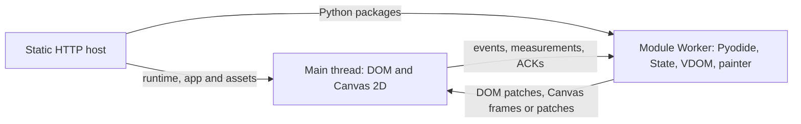

# Pyodide backend plan and remaining work

This backend is **planned, not implemented**. The architecture below is a
proposal; runtime/dependency choices still require agreement before implementation.
No Pyodide runtime has been installed or exercised for this audit.

**Pending** means work has not been implemented; **Partial** lists remaining
work in an extraction already underway; **Unverified** means runtime
evidence is still missing. Remove completed tasks from this backlog, retaining
only gaps, outstanding checks and unresolved decisions.

## Baseline and process

Source audit: `0f336292379abecaca2e7480e055ebcf17dd560c` (2026-10-16).
Use this commit's shared core and PySide6 API as the declaration/binding reference,
and its Web renderer as the browser behavior baseline. Record a newer component
SHA only when intentionally adopting changed behavior.

Work through P0, then P1, then P2. After each completed change, update this
backlog, applicable references, cookbook support flags and Changelog.txt; run
relevant checks and commit. Skip decisions that need consultation and continue
independent work. Preserve Python 3.9 compatibility in shared code and host tools.
Use public Pyodide/browser APIs; avoid monkey patches, nested event loops and
pretending browser capabilities match desktop APIs.

Keep runtime instructions in a future `doc/pyodide-reference.md`, separate from
the [common reference](../REFERENCE.md) and [Web reference](web-reference.md).
Do not advertise install/start commands or mark cookbook pages supported before
they work in an actual browser.

## Proposed architecture

Run each page's Python application in one dedicated module Web Worker. The worker
owns State, callbacks, PUI reconciliation, render diffs and Canvas painters.
The main thread owns native DOM controls, layout measurement, input collection
and Canvas 2D rendering. An ordinary HTTP static host serves the runtime,
application files and assets; application execution does not require a Python
server or WebSocket.



Reuse the existing Web widget semantics and renderer instead of implementing
another DOM widget library. Extract only the transport-independent Python and
JavaScript pieces needed by both backends, preserving public `PUI.web` imports
and behavior. Keep HTTP authentication, cookies, process supervision, proxy
settings and WebSocket compression in the Web backend.

The suggested local transport is `postMessage` with plain structured-cloneable
records. Retain render schemas and revisions, but omit WebSocket framing and
zstd by default. This avoids a compression stage for communication within one
browser; it is not a claim that structured cloning is the fastest option.
Measure it against MessagePack plus transferred buffers before considering a
binary transport. See D2.

## Proposed source layout and dependency boundary

Use an internal `PUI/_browser/` package for Python behavior shared by the two
browser backends. Keep application-facing imports under `PUI.web` and
`PUI.pyodide`. Move front-end sources from `web-client/` to `browser-client/`
when extracting the shared renderer; give each execution mode its own entry
point. The paths below describe the target layout; extraction is in progress.

```text
PUI/
  state.py, node.py, view.py, dom.py  # Existing core shared by every backend
  _browser/
    widgets.py                     # Element records, PUIView, common app base, controls
    runtime.py                     # Bindings, action dispatch, redraw/snapshot lifecycle
    render.py                      # DOM/Canvas diffs and render credit
    canvas.py, table.py             # Painter recording and table behavior
    images.py                      # Resource descriptors and crop/scale operations
    schema.py                      # Data/message-body validation and render limits
  web/
    __init__.py, application.py     # Public exports and HTTP-server start()
    runtime.py, images.py           # Native scheduling and gateway resource adapters
    server.py, worker.py            # HTTP/WebSocket gateway and Python processes
    protocol.py, messages.py        # Network codec/envelopes and session handshake
    ipc.py, sessions.py, urls.py    # Server-only infrastructure
    static/                        # Built Web assets
  pyodide/
    __init__.py, application.py     # Public exports and browser-runtime start()
    runtime.py, images.py           # Browser scheduling and local resource adapters
    bootstrap.py                   # Python side of worker startup/dispatch
    static/                        # Built Pyodide launcher/worker assets

browser-client/
  shared/
    dom.js, layout.js, table.js     # Native DOM renderer
    canvas.js, images.js            # Drawing and common decoded-image handling
    schema.js, budget.js            # Render/action validation and limits
    controller.js                  # Ordered input, coalescing, credits and revisions
    client.css                     # One source for common widget styles
  web/
    client.js, protocol.js          # WebSocket, codecs, reconnect, resume/logout
    messages.js, images.js          # Network handshake and HTTP image policy
  pyodide/
    client.js, worker.js            # Page bootstrap and Pyodide worker bridge
    images.js                      # Owned local/Blob resource policy
  build.mjs, package.json, pnpm-lock.yaml, licenses/
```

The dependency direction is `web/pyodide -> _browser -> existing PUI core` in
Python, and `web/pyodide entry -> shared renderer/controller` in JavaScript.
The shared layers must not import either backend or their network/runtime
packages. `schema` contains application data contracts; Web session fields,
compressed-frame limits and codec initialization stay in the Web transport.
The existing Web wire format should remain unchanged during this extraction.

Keep the adaptation points small:

| Concern | Shared behavior | Backend-owned behavior |
| --- | --- | --- |
| Application | View construction, child records, title and teardown | Web `start()` serves HTTP; Pyodide `start()` schedules the browser app. |
| Widgets | The same Label, Button, layouts, fields, Table and Canvas classes | Public re-exports and capability metadata. Avoid one empty subclass per widget; shared runtime type checks must see the same class identities. |
| Scheduling | Dirty-view queue, reconciliation and timer lifecycle | Native Web thread-safe wakeups versus browser-loop scheduling. Pass a scheduler/adapter explicitly; no global threading replacements. |
| Messages | Event bodies, binding references, render operations, ordering and credits | Web socket/session envelope versus local worker epoch/message delivery. Accept send/control callbacks rather than a backend-name branch in every widget. |
| Images | Resource descriptions, transforms, decode cache and release accounting | Web file registry and HTTP source validation versus worker-file transfers and registered Blob URLs. Inject source validation/resolution into both DOM and Canvas consumers; do not broaden Web's URL policy to accept arbitrary local URLs. |

Keep one maintained source for each widget, style and renderer. Build separate
Web and Pyodide bundles from those sources; generated bundles may each contain
the shared code. Continue serving Web assets from `PUI/web/static/` so source
reorganization does not change deployed asset URLs. The Pyodide build must not
pull in WebSocket/session code or zstd merely through a shared limits import.
Runtime-distribution packaging remains D3.

Migrate incrementally:

1. Extract the JavaScript shared renderer/controller and CSS; retain Web's
   bootstrap, codecs and handshake. Update build paths, test imports,
   `MANIFEST.in`, package data and documented rebuild commands together.
2. Add the Pyodide entry points/adapters against the now-shared implementation.
   Run the same widget/renderer cases through the actual browser worker.

The source layout in D1 is agreed. Frontend extraction and Pyodide adapters remain pending.
Avoid turning the common layer into a general plugin system
or moving desktop/terminal-specific behavior into it.

## Compatibility findings

The official stable documentation identifies **Pyodide 314.0.7** at this audit.
The 314.x series embeds Python 3.14; that browser runtime version does not change
PUI's shared Python 3.9 minimum. Treat 314.0.7 as a candidate to pin and test,
not a validated dependency. Current Pyodide requires a module worker, and workers
cannot manipulate the page DOM directly.
Sources: [314 release](https://blog.pyodide.org/posts/314-release/),
[worker guide](https://pyodide.org/en/stable/usage/webworker.html).

| Existing code | Reuse opportunity and missing adaptation |
| --- | --- |
| [State](../PUI/state.py), [node](../PUI/node.py), [view](../PUI/view.py), [DOM](../PUI/dom.py) | Preserve declarations, bindings and reconciliation. Verify `threading.local()` in the chosen runtime; do not assume that importing `threading` implies thread creation works. `PUIView.wait()` polls with `time.sleep()` and must not block the worker's event loop waiting for a scheduled redraw. |
| [TimelineView](../PUI/timeline.py) | Starts a `threading.Timer`; browser scheduling needs an event-loop timer with equivalent reconciliation, cancellation and teardown behavior. A small scheduler seam is preferable to replacing global threading APIs. |
| [Browser widgets](../PUI/_browser/widgets.py), [runtime](../PUI/_browser/runtime.py), [render](../PUI/_browser/render.py), [Canvas](../PUI/_browser/canvas.py), [Table](../PUI/_browser/table.py) | Validate these shared classes in the Pyodide interpreter. Supply browser-loop scheduling and a local image registry; verify runtime attachment and cleanup across worker restarts. |
| [Web worker](../PUI/web/worker.py) | Extract the serial action/render lifecycle, not its socket IPC, process handling or `asyncio.run()` entry point. Pyodide already has a browser-backed event loop. |
| [DOM renderer](../web-client/dom.js), [layout](../web-client/layout.js), [Canvas renderer](../web-client/canvas.js), [Table renderer](../web-client/table.js) | Reuse native controls, measurements, retained nodes and Canvas replay. `Renderer` already receives action/control callbacks. Do not import the WebSocket bootstrap in [client.js](../web-client/client.js). |
| [Budget validation](../web-client/budget.js), [protocol](../web-client/protocol.js) | Finish moving application/render schemas and frontend sources into the shared layout. Keep the independent render limits in [schema.js](../web-client/schema.js) separate from Web frame/window limits and codecs. |
| [Python images](../PUI/web/images.py), [browser images](../web-client/images.js) | Original-file handling and crop/scale descriptors are reusable. The gateway registry and URL validator require Web-specific HTTP paths; Pyodide needs a separate resource adapter with explicit ownership and release. |
| [Package entry](../PUI/__init__.py), [setup.py](../setup.py) | Core packaging has no mandatory backend dependencies, but importing PUI probes jurigged and imports TimelineView. Verify a plain wheel imports without server/native extras or a file watcher. Do not install the reload extra into the browser. |
| [Cookbook config](../cookbook/config.py), [app](../cookbook/app.py), [launcher](../cookbook/__main__.py) | Add an explicit backend selection before app imports. Package Python source for `inspect.getsource()` and audit optional imports/support flags. The Web login launcher and its server arguments must not run in Pyodide. |

Browser Python cannot start ordinary Python threads/processes or use native
sockets. Networking follows browser policies, including CORS; prefer asynchronous
browser HTTP APIs. Use Pyodide's existing event loop for redraw/timer scheduling,
without a blocking `run_until_complete()` loop.
Sources: [compatibility](https://pyodide.org/en/stable/usage/wasm-constraints.html),
[WebLoop](https://pyodide.org/en/stable/usage/api/python-api/webloop.html).

Pure Python wheels and compatible Pyodide binary wheels can be loaded; desktop
binary wheels are not interchangeable. The current package index lists Pygments,
Matplotlib and Shapely, but their presence does not implement PUI's
`MatplotlibCanvas` or validate the cookbook. Build a separate pinned browser
dependency manifest rather than installing every host extra.
Sources: [package loading](https://pyodide.org/en/stable/usage/loading-packages.html),
[available packages](https://pyodide.org/en/stable/usage/packages-in-pyodide.html).

## Proposed application and synchronization contract

- Export `PUI.pyodide` with the familiar `Application`, `PUIView`, `State` and
  supported widgets. Python application code should retain
  `MyApp(title='Example').start()` inside the worker. Bootstrap attaches the
  runtime before constructing the app; `start()` schedules it and returns to the
  browser event loop. `quit()` releases the runtime and stops further dispatch.
- A host-side builder/dev launcher packages an explicit entry module, application
  sources and declared assets, then serves a static output directory. It must
  work under a URL prefix and must not instantiate the UI during the build.
  Exact commands, manifest and distribution layout remain D3 decisions.
- Keep Python authoritative for model values. Binding references use
  `str(id(owner))` plus kind/key inside that worker, with existing slot,
  attachment and value revisions. No State UUID is needed for live binding;
  these IDs must not be persisted or reused across worker restarts.
- Give each worker lifetime an epoch. Check protocol/build compatibility at
  startup, apply an initial full snapshot, then revision-checked DOM patches and
  Canvas command patches. Reject stale events/ACKs from a prior worker. A base
  mismatch requests a full snapshot instead of applying a partial patch.
- Process actions serially. Reuse bounded event queues and coalesce only
  consecutive mousemove events for the same target while its callback is
  pending, preserving intervening clicks, wheel events and binding writes.
- Keep one outstanding DOM render and bounded Canvas presentation work. DOM ACK
  and Canvas presentation ACK remain separate. Assemble a complete render batch
  before sending; never post individual painter commands. Queue the latest
  desired state while awaiting credit.
- Preserve the current Canvas prefix/suffix diff and full-frame fallback on
  resize/reset or unsuitable deltas. Main-thread measurements and DPR carry
  revisions; obsolete measured frames must not be presented. A continuous painter
  requests another frame through the existing presentation-credit lifecycle.
- Convert Python records to plain JavaScript objects/arrays, not Maps or live
  PyProxy values. Keep callbacks and Python objects in the worker. Explicitly
  release bridge proxies and buffers when finished; converting records and
  posting them is not zero-copy. Retain immutable published Python records and
  avoid additional defensive copies inside the trusted runtime.
- Maintain type/shape, command-count, retained-state and queue limits. Initially
  preserve the existing render budget calculation, including its logical
  MessagePack-size estimate; that estimate is not a browser heap measurement.
  Any limit change needs evidence and a separate decision.

Proxy lifetime and conversion behavior need dedicated checks:
[Pyodide type conversions](https://pyodide.org/en/stable/usage/type-conversions.html).

## Storage, resources and lifecycle proposals

Start with one worker per page and transient State. Reload or worker termination
creates a fresh interpreter and epoch; do not promise the Web backend's cookie
session/resume/TTL behavior. Distinguish runtime HTTP caching from saving
application State. A later persistence feature should serialize explicit
application data, not Python memory or `id(obj)` references.

Pyodide's default MEMFS loses files on reload. Bundled files can be loaded into
it before app startup; user-selected files need an explicit upload/import path.
Persistent storage requires an explicit mount/sync policy and storage-failure
handling, not an assumed writable desktop filesystem.
Source: [filesystem guide](https://pyodide.org/en/stable/usage/file-system.html).

For Image/Canvas images, propose retaining `ImageResource.load(path)` for files
already in the worker filesystem. Transfer original bytes to a bounded resource
registry on the main thread and create owned Blob URLs there; retain the existing
browser crop/scale operations. Send a resource once per revision, resolve it
before presentation, and revoke URLs when no retained frame or node uses them.
Do not re-encode images or add Pillow for this. Static asset URLs can use normal
HTTP caching, but their mapping and allowed sources need D5 agreement. Keep Web's
authenticated image URL validation unchanged.

Provide loading, package-load failure, traceback and worker-failure states in
the page. A busy Python callback can delay worker messages even though the DOM
thread is separate. Initial recovery can terminate/restart the worker, losing
transient state. Graceful interruption requires SharedArrayBuffer and suitable
cross-origin-isolation headers, so it is a separate deployment choice.
Source: [interrupt support](https://pyodide.org/en/stable/usage/keyboard-interrupts.html).

Python source and packaged data are downloaded to the browser and are inspectable.
Client-side `auth` cannot protect server resources or enforce authorization.
Protected APIs must authenticate and validate requests on their server; static
hosting access control belongs at the host. Ship explicit asset manifests, not
entire working directories or environment files. Keep literal text rendering and
data-only commands; this backend is for trusted application code, not an
untrusted-code sandbox.

## Prioritized work

Implementation items below are **Pending** except the explicitly **Partial**
extraction. All Pyodide browser checks are **Unverified**. Reusing a Web module
does not by itself establish Pyodide support.

| ID | Priority | Missing work | Acceptance check |
| --- | --- | --- | --- |
| Y1 | P0 | Pin the agreed runtime and audit core imports in a real module worker. Verify wheel metadata/assets, thread-local behavior and browser loop availability. | Import PUI and a minimal app without native GUI, aiohttp, multiprocessing, zstd or jurigged installation. Record actual runtime/browser versions. |
| Y2 | P0 | **Partial:** extract JavaScript schemas/controller; add Pyodide Application/PUIView and browser timer scheduling. Remove blocking waits from the Pyodide path. | Button/State/subview redraw, timer cancellation, keyed removal and quit work; existing Web and Python 3.9 shared tests retain behavior. No monkey patches or nested loops. |
| Y3 | P0 | Build bootstrap and ordered local bridge, with explicit proxy ownership, startup epoch, render/event credits, stale-message guards and error recovery. | A real click changes Python State and DOM once. Duplicate/stale actions, delayed ACKs, malformed data, reload and worker restart cannot dispatch into retired objects. No WebSocket or codec initialization occurs. |
| Y4 | P0 | Add a minimal static build/dev route with prefix-aware asset URLs, pinned manifest and loading/error UI. | A clean browser loads the built app under `/` and a nested prefix; runtime/package failures are visible and retryable. Cold/warm downloads and time to first interactive control are measured. |
| Y5 | P1 | Validate layouts and basic controls: Window/title, HBox/VBox, Grid/Stack, Spacer/Divider, Scroll, Label/Text, Button, TextField/MaskedField, Checkbox/RadioButton, ComboBox and ProgressBar. | Reuse Web geometry/interaction cases in the actual worker harness. Check resize, approximate cross-axis centering, typing, Enter/blur commits, datalist selection/free text, disabled state, normalization and rebinding. |
| Y6 | P1 | Validate Tabs/Views and Table through the shared renderer. | Optional models and `.select()`, ID/text matching, keyed page retention, table choices/editors/prefix/suffix and unchanged cell size work. Retired list/dict bindings reject old input. |
| Y7 | P1 | Port Canvas measurement, painter batching, full/delta frames, inputs and continuous drawing. | HeavyCanvas works with 500, 1,650 and 6,000 samples; hover, wheel zoom, reset and resize preserve frame/base revisions. Only complete batches cross the bridge; sustained input stays bounded. |
| Y8 | P1 | Add the agreed file/image resource adapter and explicit bundled assets. | Image and Canvas image display/crop/scale, replacement, failed decode and removal work; transfers and Blob URLs are released after worker restart and no retained image has a prematurely revoked URL. |
| Y9 | P1 | Integrate the cookbook, source viewer and backend support flags with a pinned browser dependency manifest. | Page navigation and source viewing work from the static build. Unsupported examples are reported accurately; optional missing packages do not break unrelated pages. |
| Y10 | P1 | Exercise lifecycle, security boundaries and browser compatibility beyond the minimal app. | Actual Chromium, Firefox and Safari checks cover native events, background/foreground transitions, two independent tabs, crash/restart, long-running callbacks, bounded queues and repeated mount/teardown. Shared Web renderer changes pass Web regressions. |
| Y11 | P2 | Evaluate persistence, file import/export, graceful interrupt and offline packaging after decisions. | Explicit save/load, denied storage or permissions, unavailable headers, upgrades and cache eviction have defined behavior. No implicit session-resume promise. |
| Y12 | P2 | Evaluate optional Shapely/Matplotlib and remaining widgets. | Verify compatible wheels first. Loading Matplotlib alone does not mark MatplotlibCanvas implemented; each new adapter or dialog interaction requires a supported API and native tests. |

Tree, Splitter, general dialogs, Html/MarkDown, MatplotlibCanvas and native widget
embedding are not supplied by the current shared Web renderer. Keep those gaps
visible rather than adding success-shaped placeholders. Desktop window management
and browser user-activation requirements need explicit capability notes; do not
raise merely for harmless unsupported decoration options in shared app code.

## Performance and validation still needed

Use existing [HeavyCanvas](../cookbook/heavycanvas.py) seeded data, including
hover-only changes and large zoom replacements. Measure separately:

1. Cold/warm runtime and package loading; app import and first interactive frame.
2. Painter execution, snapshot collection, validation and DOM/Canvas diff.
3. Python-to-JavaScript conversion, message posting/receipt and main-thread apply.
4. Canvas replay/presentation and input-to-visible-frame latency.
5. Retained memory, live proxies/resources and queue size during repeated updates.

Report browser/device, viewport, DPR and sample count, plus median and tail
latencies. Measure within each context with correlation IDs; do not subtract
unadjusted timestamps from different clock origins. Compare with Web on the same
browser, but keep native-Python versus WebAssembly execution and network costs
separate. Benchmark clone transport before claiming it beats binary transfer or
removing existing diff/validation stages.

Adapt the existing [runtime](../tests/web_runtime.py),
[binding lifetime](../tests/web_binding_lifetime.py),
[render](../tests/web_render.py), [Canvas diff](../tests/web_canvas_diff.py) and
[browser interaction](../tests/web_browser.cjs) cases. Pure Python/JavaScript tests
remain useful, but cannot replace running Python in an actual browser worker.
For shared changes, retain [Python 3.9 checks](../README.md#python-39-compatibility).

## Decisions before implementation

| ID | Proposed direction | Decision and affected work |
| --- | --- | --- |
| D2 | Plain records over `postMessage`, no local zstd, preserve render batches/diffs/credits. | Agree this initial transport before Y3; use Y7 measurements to decide whether MessagePack plus transferable buffers merits a later implementation. Neither transport is assumed zero-copy from Python memory. |
| D3 | The cookbook will load pinned Pyodide 314.0.7 from the official CDN; PUI/cookbook files are served by GitHub Pages. | Runtime source/version is agreed. General application build API and optional self-hosted distribution remain to be specified. Keep browser interpreter downloads separate from host pip extras. |
| D4 | Transient State/MEMFS initially; explicit restart after failure; no required SharedArrayBuffer headers. | Agree reload/state-loss expectations. Persistence, offline guarantees and graceful interrupt need their own policy before Y11. |
| D5 | Explicit bundled files plus owned Blob resources for worker-created images. | Agree source/path mapping, resource budgets and import/export scope before Y8. Any public file API or expanded image source support needs a concrete proposal. |

Existing approvals for Web transport/server dependencies do not select Pyodide's
runtime, deployment or persistence choices. Resolve these decisions before the
dependent implementation, without blocking independent source audits and tests.
