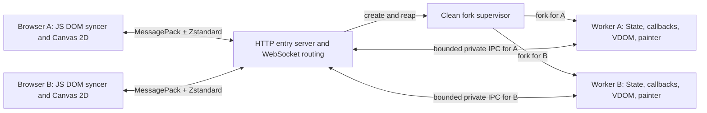

# Web backend plan and remaining work

The Web backend is **not implemented**. All implementation and validation below
is pending. This plan records the requested architecture and proposed steps;
it does not add a supported backend or an installable Web extra.

## Requested architecture

- Python runs on the server and builds the PUI VDOM from `content()` and State.
- A JavaScript DOM syncer reconciles that tree with browser DOM elements.
- Application messages use MessagePack serialization and Zstandard compression.
- Each client has a dedicated forked Python process. That worker handles one
  client and processes its events serially; the HTTP entry server can serve many
  clients concurrently.
- Canvas painter calls execute in Python, producing drawing commands that the
  browser replays through Canvas 2D.

Proposed transport: HTTP for the page and packaged static assets, with a binary
WebSocket for bidirectional application messages. One browser tab/connection
corresponds to one client. Static asset requests do not create workers.

The fork supervisor's placement and HTTP/WebSocket library remain D1/D2
decisions. The diagram proposes a gateway that owns network connections and
relays binary messages to workers. It does not require passing live HTTP/TLS
protocol objects across a fork. Worker application state stays private.

## Baseline and existing integration points

Source audit: `8074c0a8011e63c56063841ce0279a6cf91a981e` (2026-10-15).
Use this commit's shared core and PySide6 behavior as the initial reference;
record a newer component baseline only when intentionally adopting a change.

- [PUIView](../PUI/view.py) rebuilds declarations, tracks State subscriptions,
  and permits independent subview redraws. Its global view registry becomes
  worker-local through process isolation.
- [dom.sync](../PUI/dom.py) already reconciles Python node identity, retires old
  handles, manages virtual children, and invokes backend update/child hooks.
  Preserve these lifecycle rules; the Web hooks should maintain serializable
  render records rather than native widgets. JavaScript owns actual DOM diffing.
- [PUINode](../PUI/node.py) keys are not globally unique: repeated unkeyed nodes
  are valid. Its `serialize()` produces diagnostic text, not a wire format.
  Assign separate session-local wire IDs and write an explicit schema.
- [TimelineView](../PUI/timeline.py) uses timer threads. Queue redraw requests
  onto the worker's application loop; never reconcile concurrently with an event.
- Importing [PUI](../PUI/__init__.py) can start a jurigged watcher when installed.
  Resolve that startup side effect before choosing the fork entry point (D2).
- [PySide6 Canvas](../PUI/PySide6/canvas.py) supplies the painter signatures;
  [the reference](../REFERENCE.md#canvas) supplies logical-pixel, density, and
  event contracts. Native Qt quirks are findings to review, not wire semantics.

The shared framework retains Python 3.9 support. Select compatible Web
dependencies or discuss a backend-specific minimum; do not raise the shared
minimum. Standard-library `compression.zstd` was added in Python 3.14, so it
cannot be the only implementation for a Python 3.9 Web backend.
See [Python's Zstandard API](https://docs.python.org/3.14/library/compression.zstd.html).

## Proposed server lifecycle

1. Start the HTTP entry server from an application class/factory import path.
   Import application code and construct its Application/State inside each
   worker. The parent must not build a UI or run application callbacks.
2. Validate a session connection and available capacity before allocating a
   worker. Associate exactly one connection with its private IPC channel.
3. Fork from a clean, single-threaded supervisor. Close unrelated descriptors
   in the child; do not inherit other sessions' channels, timers, database
   connections, or mutable UI instances. Initialize worker resources afterwards.
4. Process input, State callbacks, queued redraws, resize notifications, and
   painter work on one worker loop. A slow callback delays its own client;
   the gateway must keep routing other clients without waiting on that worker.
5. On disconnect or quit, cancel timers, destroy the PUI tree, release resources,
   close IPC, and exit/reap the worker. Bound shutdown time and handle crashes.
   Graceful server shutdown must also stop/reap all children.

Python documents hazards when forking multithreaded processes; Python 3.14 also
changed process-start defaults. Request the selected start method explicitly.
Do not silently replace the requested fork design with `spawn`. Initially
targeting Linux is proposed; other server platforms need a separate decision.
See [Python process start methods](https://docs.python.org/3.14/library/multiprocessing.html#contexts-and-start-methods).

Reconnect/state retention is D4. The simplest initial policy is to end the old
worker and start a new session, with a visible reset rather than replaying old
events. Process isolation separates Python memory, not filesystem/database
contents; applications still explicitly own any shared external data.

## Proposed wire protocol and JS syncer

Use a versioned schema with deterministic Python/JavaScript fixtures before
implementing widgets. Proposed message families:

| Message | Direction | Purpose |
| --- | --- | --- |
| `hello` / `ready` | Both | Protocol/build compatibility, codec capability, viewport and density |
| `render` | Server to client | Session epoch, increasing render revision, full render tree, and associated Canvas/resource revisions |
| `event` | Client to server | Event sequence, observed render revision, node ID, handler registration token, event type and typed payload |
| `measure` | Client to server | Current Canvas size/density and explicitly requested browser measurements |
| `ack` / `resync` | Both | Applied render/processed event sequence, or request for a fresh full snapshot |
| `resource` / `release` | Server to client | Versioned image/font resources and lifetime management |
| `close` / `error` | Both | Session termination or bounded protocol/application diagnostics |

First implement complete tree snapshots after coalesced redraws. JS diffs those
snapshots against its current render tree; a snapshot must not mean replacing the
whole DOM. Subtree snapshots or other bandwidth optimizations can follow actual
measurements. The server must publish a consistent full tree after independently
updated subviews, not just the latest `content()` return value.

Render records contain only an allowlisted component type, wire ID, resolved
properties, ordered children and event subscriptions. Python callables, bindings,
application objects and State internals stay on the server. Wire IDs survive
matched nodes and keyed moves, are unique even for duplicate PUI keys, and are
never reused within a session. Resolve events to current nodes; reject removed
nodes, stale handler registrations, duplicate sequences and disabled actions.
An older render revision alone must not discard valid queued typing/clicks on a
still-current registration.

Keep virtual-view ordering and boundaries in the Python tree; materialize the
browser hierarchy without extra layout wrappers for virtual nodes. JS must reuse
and move existing DOM nodes, remove obsolete properties/listeners, and clean up
observers/resources on destruction. Test actual focus, selection, scroll and
uncommitted edits through reorder and removal.

Text inputs need local edit sequences and server acknowledgements so a delayed
snapshot cannot overwrite newer typing. Handle IME composition, blur/Enter
commits and commit-before-click ordering. Programmatic updates must not echo
events. Keep one-shot imperative requests separate from coalescible render
state so they cannot disappear when a newer snapshot replaces a pending one.

Each application message should be one independently decompressible Zstandard
frame containing one MessagePack value; avoid compression state shared between
clients. Define bootstrap/version negotiation before decoding application data.
Select exact framing, size limits and codec packages in D1/D3. Specify binary
data, string map keys, null, finite numbers and integers within JavaScript's safe
range; larger application values need explicit representations. Never use
pickle, `eval`, arbitrary method lookup or direct object-dictionary serialization.
See the [MessagePack specification](https://github.com/msgpack/msgpack/blob/master/spec.md).

Bound compressed/uncompressed sizes, nesting, node/command counts, decompressor
window memory and queued bytes. Serialize asynchronous decoding to retain message
order. Apply backpressure with render acknowledgements and bounded IPC queues;
keep at most the agreed number of in-flight snapshots and the latest unsent
snapshot. Preserve ordered input and one-shot actions; overflow must be explicit.
Do not silently sample mouse movement before agreeing its effect on drawing
callbacks (D5). The browser [WebSocket API](https://developer.mozilla.org/en-US/docs/Web/API/WebSocket)
does not provide automatic receive backpressure.

Zstandard applies to the application payload, independently of HTTP asset
compression or WebSocket `permessage-deflate`; avoid redundant compression.
Browser `CompressionStream("zstd")` and `DecompressionStream("zstd")` support
must be checked for both directions and every target browser. A JS/WASM codec
may be needed; do not assume HTTP zstd support provides a WebSocket codec.
See [compression](https://developer.mozilla.org/en-US/docs/Web/API/CompressionStream/CompressionStream)
and [decompression](https://developer.mozilla.org/en-US/docs/Web/API/DecompressionStream/DecompressionStream).

## Proposed Canvas command recorder

Keep `Canvas(painter, *args)` and the current painter method signatures. Run the
callback in the worker with a recording Canvas. Send allowlisted opcodes and
typed arguments, not Python or generated JavaScript source. Start with complete
display lists per Canvas revision; client replay resets drawing state and clears
the previous frame before applying the background and commands.

| Painter API | Planned browser mapping / outstanding work |
| --- | --- |
| `drawLine`, `drawPolyline`, `drawCubicBezier` | Canvas 2D paths with explicit stroke/color/width and per-command state isolation |
| `drawPolygon`, `drawRect`, `drawEllipse` | Paths/fill/stroke; retain rectangle endpoint and ellipse center/radius semantics |
| `drawText` | Text/font/color/rotation commands; decide anchors, bounds/clipping and font metrics against the reference before claiming parity |
| `loadImage`, `ImageResource.load/crop/scale`, `drawImage` | Resource IDs/bytes, source and destination rectangles, opacity and transform metadata; decoding/readiness and image dimensions need D6 |
| `drawShapely` | Convert server geometry into paths, including polygon holes/fill rules; keep geometry objects server-side and dependencies optional |

Use `ResizeObserver` and device-pixel-ratio notifications to report logical
Canvas dimensions. Wait for positive finite dimensions before the first painter
call. Size the backing bitmap for density while keeping painter/event coordinates
in logical pixels. Resize or density changes replay/redraw the current content;
stale node/size/frame revisions must not paint over newer frames.

Replay on `requestAnimationFrame`. A truthy painter result requests a later
worker paint, paced by client frame credits/acknowledgements rather than a busy
server loop. Hidden tabs, slow clients, removal and disconnect must stop unbounded
frame production. Frame rate remains limited by network and Python painter cost.

Forward registered pointer, double-click, enter/leave, keyboard/modifier and wheel
events to Python. Use pointer capture for dragging outside the Canvas and report
cancellation. Do not implement application hit-testing or speculative state
changes in JavaScript as an implicit substitute for Python callbacks.

Pixel-mode wheel input maps to `x_delta`/`y_delta` with the existing PUI sign
convention. Angular `h_delta`/`v_delta` stay zero when the browser provides no
angular measurement. Browser wheel deltas can also be lines/pages; agree their
representation/conversion in D5, with no fixed pixel-to-angle ratio.
See [WheelEvent.deltaMode](https://developer.mozilla.org/en-US/docs/Web/API/WheelEvent/deltaMode).

## Prioritized implementation backlog

Every row is **Missing** until implemented and checked. Work through P0 first;
skip decision-blocked items and continue independent work.

| ID | Priority | Remaining work | Acceptance check / decision dependency |
| --- | --- | --- | --- |
| W1 | P0 | Finalize schema and Python/JS codec fixtures, frame limits, version mismatch behavior | Round-trip Unicode, null, binary and numeric boundaries; reject invalid/oversized frames; D1/D3 |
| W2 | P0 | HTTP entry, session routing, clean fork startup and worker teardown | Two clients have different PIDs and isolated State; slow/crashed worker leaves the other usable; no workers for assets, descriptor leaks or zombies; D1/D2/D4 |
| W3 | P0 | Web render-record hooks and coalesced worker scheduling | Retired handles, independent subviews, virtual nodes, duplicate keys, timer updates and deletion match shared lifecycle; no browser work in the parent |
| W4 | P0 | JS DOM syncer and event dispatch | Keyed insert/move/remove preserves DOM identity/focus; callbacks are current and run once; delayed events for removed/disabled nodes are ignored |
| W5 | P0 | Application/page shell, VBox/HBox, Label, Button, TextField and basic styles | End-to-end State binding, `.click()`, enabled/placeholder, typing/IME, normalization, blur-before-click and property removal work |
| W6 | P0 | Canvas recorder/replayer for geometric primitives, resize/density and pointer input | Cookbook-like drawing and dragging run over the real codec/transport; finite initial sizing, HiDPI and cancellation verified; input policy D5 |
| W7 | P0 | Flow control, session errors and shutdown under load | Slow browser/worker has bounded queues; malformed or old-session messages cannot affect another client; server quit reaps all children |
| W8 | P1 | Canvas text, images, continuous painting and remaining wheel modes | Anchor/clipping, resource readiness/release, opacity, resize, hidden tabs and frame pacing verified in target browsers; D5/D6 |
| W9 | P1 | Checkbox/RadioButton/ComboBox, Text, ProgressBar, Grid, Scroll and style parity | Typed choice values, two-way bindings, keyboard access, layout reset and retained scroll positions match documented browser capabilities |
| W10 | P1 | Tabs and Views with optional models and `.select()` | ID/text fallback and first-match behavior; Views changes only programmatically; retained page DOM, edits/focus/scroll and empty selection |
| W11 | P1 | Table/Tree and declarative dialogs | Typed choices and editing, stable identities, selection and expansion retention; choose dialog/result and large-data behavior before implementation |
| W12 | P1 | Package JS/CSS/approved codec assets and expose the Web extra/entry point | Installed wheel serves assets without source checkout or an end-user Node toolchain; Python 3.9/backend compatibility tested; D1-D3 |
| W13 | P2 | Image/Markdown/HTML, Shapely, Splitter, browser file operations and window commands | Record supported semantics and explicit gaps; approve new dependencies and desktop-to-browser differences before implementation |
| W14 | P2 | Browser/platform, accessibility, performance and deployment validation | Real browser keyboard/screen-reader semantics; measured startup bytes, RSS/client, latency and frame throughput; no claimed capacity without measurements |

Initially propose one browser page per Application. Additional native windows,
MDI, native-widget interop and synchronous desktop dialogs need a browser-specific
contract. Fullscreen is subject to browser user-activation rules; maximize cannot
be promised as an OS-window operation. Keep these unsupported until designed.

## Decisions before dependent implementation

- **D1 — Transport and packages:** confirm the proposed HTTP + binary WebSocket
  transport, gateway/IPC ownership and HTTP/WebSocket implementation. MessagePack
  and Zstandard are selected by the request; their Python/JS package choices,
  bundling/build/test dependencies and version constraints still need approval.
- **D2 — Fork startup and platforms:** choose a clean dedicated fork supervisor
  (recommended) or a demonstrably thread-free entry process. Agree initial Linux
  support and how to prevent PUI's import-time hot-reload watcher before forking.
  Any shared startup refactor needs review; no fork of a running threaded app.
- **D3 — Browser codec baseline:** choose supported browsers and native zstd
  versus an approved JS/WASM codec. Both compression directions must work before
  accepting the connection. Do not silently fall back to JSON/gzip or change the
  protocol to avoid this decision. Benchmark before considering small-message
  compression exceptions or dictionaries.
- **D4 — Connection lifetime:** recommend a fresh worker/session after reload or
  disconnect for the first version. Session resumption would require a defined
  grace period, authenticated reattachment and stale-event policy.
- **D5 — Input semantics:** decide line/page wheel handling and whether motion
  coalescing is opt-in. Preserve click/press/release and editor commit ordering;
  do not discard drawing samples as an undocumented performance optimization.
- **D6 — Browser rendering gaps:** settle text metrics/anchor/clipping, image
  decode/dimensions and synchronous resource APIs before those Canvas features;
  separately agree dialogs, files and desktop window mappings when reached.

## Implementation and validation process

Use Application/PUIView classes and explicit arguments for new public APIs.
Start with backend-local render records, public browser DOM/Canvas APIs and
existing shared bindings. Avoid monkey patches, hidden whole-DOM rebuilds and
new frameworks introduced solely to bypass lifecycle work.

For each completed implementation change, run focused checks, update
[REFERENCE.md](../REFERENCE.md), [Reference.html](Reference.html), cookbook
availability and [Changelog.txt](../Changelog.txt) as applicable, then commit.
Remove completed rows from this backlog; keep missing/partial behavior, pending
decisions and unverified checks. Move established contracts into the reference.
Do not add delivery/completion sections or temporary artifact paths.

Validation must include Python/JS protocol fixtures, real browser interaction,
two-worker isolation, lifecycle teardown and Canvas replay. Test late/duplicate
events, revision mismatch, local typing ahead of server state, changing handlers,
reordered nodes, resize storms, backpressure, malformed frames and disconnect
during painting. Compare render records/commands deterministically, and use
browser pixels/geometry checks where visual behavior matters. DOM mocks alone
do not establish focus, IME, Canvas or layout correctness.

Run existing shared lifecycle/State tests and `make check-python39` if shared
code changes. Keep Web runtime/browser checks separate from the existing Qt
baseline. Document the actually tested browsers and server versions; no backend
support flags, performance guarantees or install instructions before validation.
