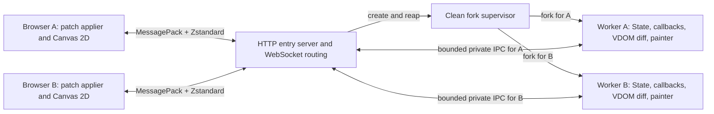

# Web backend plan and remaining work

The Web backend is **not runnable yet**. Internal work has started; the backlog
below lists remaining implementation and validation. No supported backend or
installable Web extra is exposed yet. Internal contracts are in [web-api.md](web-api.md).

## Requested architecture

- Python runs on the server, builds the PUI VDOM from `content()` and State,
  and calculates render diffs against the client's acknowledged state.
- JavaScript applies patches with stable node IDs and base/target revisions.
  Full snapshots establish the initial tree or recover a desynchronized client;
  batch deduplication and ACKs make render retransmission safe.
- Application messages use MessagePack serialization and Zstandard compression.
- State bindings synchronize by the server-side `id(obj)` of their owning
  object, together with the bound attribute/key/index. Identity is scoped to the
  client session; Python remains authoritative for values and callbacks.
- Each client has a dedicated forked Python process. That worker handles one
  client and processes its events serially; the HTTP entry server can serve many
  clients concurrently.
- Canvas painter calls execute in Python, producing drawing commands that the
  browser replays through Canvas 2D.

Proposed transport: HTTP for the page and packaged static assets, with a binary
WebSocket for bidirectional application messages. One browser tab/connection
corresponds to one client. Static asset requests do not create workers.
The entry page, assets and WebSocket must respect configurable `base_url`, with
a separate upstream mount path for proxies that strip the public URL prefix.

The fork supervisor's placement and HTTP/WebSocket library remain D1/D2
decisions. The diagram proposes a gateway that owns network connections and
relays binary messages to workers. It does not require passing live HTTP/TLS
protocol objects across a fork. Worker application state stays private.

## Baseline and existing integration points

Source audit: `8074c0a8011e63c56063841ce0279a6cf91a981e` (2026-10-15).
Use this commit's shared core and PySide6 behavior as the initial reference;
record a newer component baseline only when intentionally adopting a change.

- [PUIView](../PUI/view.py) rebuilds declarations, tracks State subscriptions,
  and permits independent subview redraws. Its global view registry becomes
  worker-local through process isolation.
- [dom.sync](../PUI/dom.py) already reconciles Python node identity, retires old
  handles, manages virtual children, and invokes backend update/child hooks.
  Preserve these lifecycle rules; the Web hooks should maintain serializable
  render records rather than native widgets. Python diffs these records against
  the acknowledged render state; JavaScript applies the resulting operations.
- [PUINode](../PUI/node.py) keys are not globally unique: repeated unkeyed nodes
  are valid. Its `serialize()` produces diagnostic text, not a wire format.
  Assign separate session-local wire IDs and write an explicit schema.
- [TimelineView](../PUI/timeline.py) uses timer threads. Queue redraw requests
  onto the worker's application loop; never reconcile concurrently with an event.
- [State bindings](../PUI/state.py) recreate AttrBinding/ListBinding/DictBinding
  wrappers on each `state(key)` call. Identify their source with
  `id(binding.state)`, binding kind and key; [table editing](../PUI/_table.py)
  already uses that source identity to detect rebinding.
- Importing [PUI](../PUI/__init__.py) can start a jurigged watcher when installed.
  Resolve that startup side effect before choosing the fork entry point (D2).
- [PySide6 Canvas](../PUI/PySide6/canvas.py) supplies the painter signatures;
  [the reference](../REFERENCE.md#canvas) supplies logical-pixel, density, and
  event contracts. Native Qt quirks are findings to review, not wire semantics.

The shared framework retains Python 3.9 support. Select compatible Web
dependencies or discuss a backend-specific minimum; do not raise the shared
minimum. Standard-library `compression.zstd` was added in Python 3.14, so it
cannot be the only implementation for a Python 3.9 Web backend.
See [Python's Zstandard API](https://docs.python.org/3.14/library/compression.zstd.html).

## Proposed server lifecycle

1. Start the HTTP entry server from an application class/factory import path.
   Import application code and construct its Application/State inside each
   worker. The parent must not build a UI or run application callbacks.
2. Validate a session connection and available capacity before allocating a
   worker. Associate exactly one connection with its private IPC channel.
3. Fork from a clean, single-threaded supervisor. Close unrelated descriptors
   in the child; do not inherit other sessions' channels, timers, database
   connections, or mutable UI instances. Initialize worker resources afterwards.
4. Process input, State callbacks, queued redraws, resize notifications, and
   painter work on one worker loop. A slow callback delays its own client;
   the gateway must keep routing other clients without waiting on that worker.
5. On disconnect or quit, cancel timers, destroy the PUI tree, release resources,
   close IPC, and exit/reap the worker. Bound shutdown time and handle crashes.
   Graceful server shutdown must also stop/reap all children.

Python documents hazards when forking multithreaded processes; Python 3.14 also
changed process-start defaults. Request the selected start method explicitly.
Do not silently replace the requested fork design with `spawn`. Initially
targeting Linux is proposed; other server platforms need a separate decision.
See [Python process start methods](https://docs.python.org/3.14/library/multiprocessing.html#contexts-and-start-methods).

Reconnect/state retention is D4. The simplest initial policy is to end the old
worker and start a new session, with a visible reset rather than replaying old
events. Process isolation separates Python memory, not filesystem/database
contents; applications still explicitly own any shared external data.

## API integration still needed

The proposed intermediate contract is in [web-api.md](web-api.md). It defines
bootstrap/framing, message envelopes, server-generated patches, snapshot recovery,
object-ID bindings, ordered edits/events, Canvas commands, resource lifetime and
flow control.
These schemas are drafts; writing the proposal does not complete W1 or establish
runtime support.

- Validate Python/JS codec round trips and version/size handling before building
  widgets. Keep HTTP/WebSocket and codec package choices under D1/D3.
- Implement server render records, diff generation and source/attachment
  registries against existing State/lifecycle hooks. Built-in bindings use
  `id(binding.state)` plus kind/key; the shared State API does not gain UUIDs.
- Implement client patch validation/application and snapshot recovery with stable
  node IDs, retained input/IME drafts, authoritative binding readback and ACKs.
  Preserve TextField model/edit_model and commit-before-click ordering. Empty
  patches must reconcile retained canonical values when `processed_seq` advances.
- Keep an acknowledged baseline, one immutable outstanding render and the latest
  desired state. Verify duplicate renders/ACKs, stale bases and partial DOM
  failure without replaying callbacks. The initial single-batch window limits
  throughput by ACK latency; benchmark before proposing a multi-batch window.
- Record painter calls server-side and send complete lists only for changed
  Canvas records in patches; snapshots include every ready Canvas. Reset/replay
  frames in the browser without accumulating drawing state or duplicate credits.
  Verify logical sizes/DPR, geometry, input and frame pacing before expanding to
  text, images, Shapely and other capability-gated commands.
- Exercise two-client process isolation, bounded queues, stale registrations,
  object-ID reuse, resync and worker cleanup through the actual transport.

## Prioritized implementation backlog

Every row lists **remaining work**; internal helpers do not establish end-to-end
support. Work through P0 first, skipping decision-blocked items while continuing
independent work.

| ID | Priority | Remaining work | Acceptance check / decision dependency |
| --- | --- | --- | --- |
| W1 | P0 | Validate the [API proposal](web-api.md) and implement Python/JS codec fixtures, frame limits and version mismatch behavior | Round-trip Unicode, null, binary, numeric boundaries, decimal-string object IDs and typed keys; reject invalid/oversized frames; D1/D3 |
| W2 | P0 | HTTP entry, public/upstream URL integration, session routing, clean fork startup and worker teardown | Prefix-preserving/stripping proxies load the page, assets and WebSocket; HTTPS resolves to WSS; clients have isolated PIDs/State; no workers for assets, descriptor leaks or zombies; D1/D2/D4 |
| W3 | P0 | Web render-record hooks, server diff generation, object-ID binding registry and coalesced worker scheduling | Patch application equals the target state; diff uses the acknowledged baseline; independent subviews, virtual nodes, duplicate keys, moves/deletion and timer updates retain shared lifecycle; recreated wrappers retain source identity and retired registrations release owners |
| W4 | P0 | JS patch applier, snapshot recovery, binding value synchronization and event dispatch | Keyed moves preserve focus; shared controls and no-op/rejected edits reconcile even with empty patches; duplicates cannot repeat effects; stale bases/partial failures recover; stale tokens, reused IDs, old sessions and disabled writes are rejected |
| W5 | P0 | Application/page shell, VBox/HBox, Label, Button, TextField and basic styles | End-to-end object-ID binding, `.click()`, enabled/placeholder, typing/IME, rejected/normalized edits, rebinding, list/key structural changes, blur-before-click and property removal work |
| W6 | P0 | Canvas recorder/replayer for geometric primitives, resize/density and pointer input | Cookbook-like drawing and dragging run over the real codec/transport; finite initial sizing, HiDPI and cancellation verified; input policy D5 |
| W7 | P0 | Render ACK/retry/coalescing, bounded recovery, session errors and shutdown under load | Lost/duplicate ACKs cannot advance the baseline twice, free newer credit or repeat animation/resource effects; immutable retries and recovery stay bounded; slow/crashed clients remain isolated; server quit reaps all children |
| W8 | P1 | Canvas text, images, continuous painting and remaining wheel modes | Anchor/clipping, resource readiness/release, opacity, resize, hidden tabs and frame pacing verified in target browsers; D5/D6 |
| W9 | P1 | Checkbox/RadioButton/ComboBox, Text, ProgressBar, Grid, Scroll and style parity | Typed choice values, two-way bindings, keyboard access, layout reset and retained scroll positions match documented browser capabilities |
| W10 | P1 | Tabs and Views with optional models and `.select()` | ID/text fallback and first-match behavior; Views changes only programmatically; retained page DOM, edits/focus/scroll and empty selection |
| W11 | P1 | Table/Tree and declarative dialogs | Typed choices and editing, stable identities, selection and expansion retention; choose dialog/result and large-data behavior before implementation |
| W12 | P1 | Package JS/CSS/approved codec assets and expose the Web extra/entry point | Installed wheel serves assets without source checkout or an end-user Node toolchain; Python 3.9/backend compatibility tested; D1-D3 |
| W13 | P2 | Image/Markdown/HTML, Shapely, Splitter, browser file operations and window commands | Record supported semantics and explicit gaps; approve new dependencies and desktop-to-browser differences before implementation |
| W14 | P2 | Browser/platform, accessibility, performance and deployment validation | Real browser keyboard/screen-reader semantics; measured startup/patch bytes, diff CPU, RSS/client, RTT/input latency and Canvas throughput; benchmark patch versus snapshot cost and a possible bounded multi-batch window before changing policy |

Initially propose one browser page per Application. Additional native windows,
MDI, native-widget interop and synchronous desktop dialogs need a browser-specific
contract. Fullscreen is subject to browser user-activation rules; maximize cannot
be promised as an OS-window operation. Keep these unsupported until designed.

## Decisions before dependent implementation

- **D1 — Transport and packages:** confirm the proposed HTTP + binary WebSocket
  transport, gateway/IPC ownership and HTTP/WebSocket implementation. MessagePack
  and Zstandard are selected by the request; their Python/JS package choices,
  bundling/build/test dependencies and version constraints still need approval.
- **D2 — Fork startup and platforms:** choose a clean dedicated fork supervisor
  (recommended) or a demonstrably thread-free entry process. Agree initial Linux
  support and how to prevent PUI's import-time hot-reload watcher before forking.
  Any shared startup refactor needs review; no fork of a running threaded app.
- **D3 — Browser codec baseline:** choose supported browsers and native zstd
  versus an approved JS/WASM codec. Both compression directions must work before
  accepting the connection. Do not silently fall back to JSON/gzip or change the
  protocol to avoid this decision. Benchmark before considering small-message
  compression exceptions or dictionaries.
- **D4 — Connection lifetime:** recommend a fresh worker/session after reload or
  disconnect for the first version. Session resumption would require a defined
  grace period, authenticated reattachment and stale-event policy.
- **D5 — Input semantics:** decide line/page wheel handling and whether motion
  coalescing is opt-in; agree browser default scrolling/context-menu behavior.
  Preserve click/press/release and editor commit ordering;
  do not discard drawing samples as an undocumented performance optimization.
- **D6 — Browser rendering gaps:** settle text metrics/anchor/clipping, image
  decode/dimensions and synchronous resource APIs before those Canvas features;
  separately agree dialogs, files and desktop window mappings when reached.

## Implementation and validation process

Use Application/PUIView classes and explicit arguments for new public APIs.
Start with backend-local render records, public browser DOM/Canvas APIs and
existing shared bindings. Avoid monkey patches, hidden whole-DOM rebuilds and
new frameworks introduced solely to bypass lifecycle work.

For each completed implementation change, run focused checks, update
[REFERENCE.md](../REFERENCE.md), [Reference.html](Reference.html), cookbook
availability and [Changelog.txt](../Changelog.txt) as applicable, then commit.
Remove completed rows from this backlog; keep missing/partial behavior, pending
decisions and unverified checks. Move established contracts into the reference.
Do not add delivery/completion sections or temporary artifact paths.

Validation must include Python/JS protocol fixtures, real browser interaction,
two-worker isolation, lifecycle teardown and Canvas replay. Test immutable render
retries, lost/duplicate ACKs, wrong bases, partial application failure, snapshot
recovery and late/duplicate events. Check local typing ahead of server state,
empty patches confirming rejected edits, changing handlers,
recreated binding wrappers, shared bound slots, object ID reuse, registry cleanup,
list index shifts, dictionary slot recreation, reordered nodes, resize storms,
backpressure, malformed frames and disconnect during painting. Compare server
patch results against target records and Canvas commands deterministically,
and use browser pixels/geometry checks where
visual behavior matters. DOM mocks alone do not establish focus, IME, Canvas or
layout correctness.

Run existing shared lifecycle/State tests and `make check-python39` if shared
code changes. Keep Web runtime/browser checks separate from the existing Qt
baseline. Document the actually tested browsers and server versions; no backend
support flags, performance guarantees or install instructions before validation.
