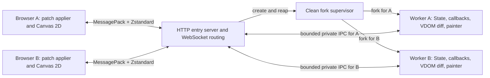

# Web backend plan and remaining work

The experimental Web cookbook runs with `make web` at
`http://localhost:8866/pui/`. This document tracks remaining work only; available
APIs are in [the reference](../REFERENCE.md) and the [wire contract](web-api.md).
The current runtime is Linux-only and serves the basic cookbook subset. Canvas
and the broader desktop widget API remain unimplemented.

## Requested architecture

- Python runs on the server, builds the PUI VDOM from `content()` and State,
  and calculates render diffs against the client's acknowledged state.
- JavaScript applies patches with stable node IDs and base/target revisions.
  Full snapshots establish the initial tree or recover a desynchronized client;
  batch deduplication and ACKs make render retransmission safe.
- Application messages use MessagePack serialization and Zstandard compression.
- State bindings synchronize by the server-side `id(obj)` of their owning
  object, together with the bound attribute/key/index. Identity is scoped to the
  client session; Python remains authoritative for values and callbacks.
- Each client has a dedicated forked Python process. That worker handles one
  client and processes its events serially; the HTTP entry server can serve many
  clients concurrently.
- Canvas painter calls execute in Python, producing drawing commands that the
  browser replays through Canvas 2D.

Transport: HTTP for the page and packaged static assets, with a binary
WebSocket for bidirectional application messages. One browser tab/connection
corresponds to one client. Static asset requests do not create workers.
The entry page, assets and WebSocket must respect configurable `base_url`, with
a separate upstream mount path for proxies that strip the public URL prefix.

The gateway uses aiohttp and the standard-library `forkserver` context with an
empty preload list. Its clean supervisor forks workers before PUI/application
imports. The diagram shows the gateway that owns network connections and
relays binary messages to workers. It does not require passing live HTTP/TLS
protocol objects across a fork. Worker application state stays private.

## Baseline and existing integration points

Source audit: `8074c0a8011e63c56063841ce0279a6cf91a981e` (2026-10-15).
Use this commit's shared core and PySide6 behavior as the initial reference;
record a newer component baseline only when intentionally adopting a change.

- [PUIView](../PUI/view.py) rebuilds declarations, tracks State subscriptions,
  and permits independent subview redraws. Its global view registry becomes
  worker-local through process isolation.
- [dom.sync](../PUI/dom.py) already reconciles Python node identity, retires old
  handles, manages virtual children, and invokes backend update/child hooks.
  Preserve these lifecycle rules; the Web hooks should maintain serializable
  render records rather than native widgets. Python diffs these records against
  the acknowledged render state; JavaScript applies the resulting operations.
- [PUINode](../PUI/node.py) keys are not globally unique: repeated unkeyed nodes
  are valid. Its `serialize()` produces diagnostic text, not a wire format.
  Assign separate session-local wire IDs and write an explicit schema.
- [TimelineView](../PUI/timeline.py) uses timer threads. Queue redraw requests
  onto the worker's application loop; never reconcile concurrently with an event.
- [State bindings](../PUI/state.py) recreate AttrBinding/ListBinding/DictBinding
  wrappers on each `state(key)` call. Identify their source with
  `id(binding.state)`, binding kind and key; [table editing](../PUI/_table.py)
  already uses that source identity to detect rebinding.
- Importing [PUI](../PUI/__init__.py) can start a jurigged watcher when installed.
  The forkserver uses an empty preload list so this occurs only after a worker
  has forked, not inside the supervisor.
- [PySide6 Canvas](../PUI/PySide6/canvas.py) supplies the painter signatures;
  [the reference](../REFERENCE.md#canvas) supplies logical-pixel, density, and
  event contracts. Native Qt quirks are findings to review, not wire semantics.

The shared framework retains Python 3.9 support. Select compatible Web
dependencies or discuss a backend-specific minimum; do not raise the shared
minimum. Standard-library `compression.zstd` was added in Python 3.14, so it
cannot be the only implementation for a Python 3.9 Web backend.
See [Python's Zstandard API](https://docs.python.org/3.14/library/compression.zstd.html).

## Lifecycle validation still needed

Further checks are needed for long-running connection/expiry/shutdown races,
descriptor/memory soak tests and slow-browser outbound queues.
The clean fork supervisor is Linux-only; other platforms need a separate design.

## API integration still needed

The current intermediate contract and unimplemented capabilities are in [web-api.md](web-api.md). It defines
bootstrap/framing, message envelopes, server-generated patches, snapshot recovery,
object-ID bindings, ordered edits/events, Canvas commands, resource lifetime and
flow control.
Only the advertised capabilities are enabled; the remaining protocol sections
do not imply support for those widgets.

- Run shared malformed-frame/message fixtures on Firefox/Safari and measure
  decoder limits there; add schemas with new Canvas/resource capabilities.
- Extend binding lifetime checks to long-running registration churn.
- Validate native desktop/mobile IMEs, focus retention across browser engines,
  and basic widget geometry on other engines. Repeat the Chrome recovery scenarios there.
- Add server outbound overload reporting
  around the existing single-credit render stream. Stress slow-browser byte
  budgets and long-running callbacks.
- Implement Canvas recorder/replayer, measurements and independent presentation
  credits. The current client advertises no Canvas capability.

## Prioritized implementation backlog

Every row lists **remaining work**; internal helpers do not establish end-to-end
support. Work through P0 first, skipping decision-blocked items while continuing
independent work.

| ID | Priority | Remaining work | Acceptance check / decision dependency |
| --- | --- | --- | --- |
| W1 | P0 | Firefox/Safari framing and message validation | Run the shared malformed fixtures and current dispatch checks on additional browser engines; D3 |
| W2 | P0 | Lifecycle soak/race checks | Long-running descriptor/memory usage and expiry/shutdown races |
| W4 | P0 | Native IME and cross-engine focus/recovery validation | Real input methods and recovery behavior on browsers beyond Chrome |
| W5 | P0 | Broader basic layout/scroll parity | Nested scroll geometry, cross-engine sizing and responsive/mobile layouts |
| W6 | P0 | Canvas recorder/replayer, resize/density and pointer input | Real browser geometry/drawing; input policy D5 |
| W7 | P0 | Independent Canvas credits and outbound overload handling | Slow browsers, byte budgets and bounded recovery |
| W8 | P1 | Canvas text/images/continuous painting and remaining wheel modes | Resource readiness, clipping, anchors, hidden tabs and pacing; D5/D6 |
| W9 | P1 | Checkbox/RadioButton/ComboBox and programmatic Scroll | Typed values, two-way bindings, keyboard/layout parity and scroll offset semantics |
| W10 | P1 | Tabs/Views, optional models and `.select()` | ID/text matching and retention across inactive pages |
| W11 | P1 | Table/Tree and declarative dialogs | Stable editing/selection, typed choices; dialog/result decisions before implementation |
| W12 | P1 | Broader installed-package environment validation | Installed wheel assets verified; other server platforms and browser versions remain unverified |
| W13 | P2 | Image/HTML/Markdown, Shapely, Splitter, files and window commands | Explicit browser semantics and new dependency decisions |
| W14 | P2 | Accessibility, deployment and performance validation | Screen readers, CPU/RSS/client, bytes/latency, Canvas throughput and patch/snapshot costs |

Initially propose one browser page per Application. Additional native windows,
MDI, native-widget interop and synchronous desktop dialogs need a browser-specific
contract. Fullscreen is subject to browser user-activation rules; maximize cannot
be promised as an OS-window operation. Keep these unsupported until designed.

## Decisions before dependent implementation

- **D3 — Browser baseline:** Chrome is tested. Validate Firefox/Safari before
  claiming support. The approved build uses @msgpack/msgpack, @bokuweb/zstd-wasm
  and esbuild; additional dependencies still require approval.
- **D5 — Input semantics:** decide line/page wheel handling and whether motion
  coalescing is opt-in; agree browser default scrolling/context-menu behavior.
  Preserve click/press/release and editor commit ordering;
  do not discard drawing samples as an undocumented performance optimization.
- **D6 — Browser rendering gaps:** settle text metrics/anchor/clipping, image
  decode/dimensions and synchronous resource APIs before those Canvas features;
  separately agree dialogs, files and desktop window mappings when reached.

## Implementation and validation process

Use Application/PUIView classes and explicit arguments for new public APIs.
Start with backend-local render records, public browser DOM/Canvas APIs and
existing shared bindings. Avoid monkey patches, hidden whole-DOM rebuilds and
new frameworks introduced solely to bypass lifecycle work.

For each completed implementation change, run focused checks, update
[REFERENCE.md](../REFERENCE.md), [Reference.html](Reference.html), cookbook
availability and [Changelog.txt](../Changelog.txt) as applicable, then commit.
Remove completed rows from this backlog; keep missing/partial behavior, pending
decisions and unverified checks. Move established contracts into the reference.
Do not add delivery/completion sections or temporary artifact paths.

Validation must include Python/JS protocol fixtures, real browser interaction,
two-worker isolation, lifecycle teardown and Canvas replay. Test immutable render
retries, lost/duplicate ACKs, wrong bases, partial application failure, snapshot
recovery and late/duplicate events. Check local typing ahead of server state,
empty patches confirming rejected edits, changing handlers,
recreated binding wrappers, shared bound slots, object ID reuse, registry cleanup,
list index shifts, dictionary slot recreation, reordered nodes, resize storms,
backpressure, malformed frames and disconnect during painting. Compare server
patch results against target records and Canvas commands deterministically,
and use browser pixels/geometry checks where
visual behavior matters. DOM mocks alone do not establish focus, IME, Canvas or
layout correctness.

Run existing shared lifecycle/State tests and `make check-python39` if shared
code changes. Keep Web runtime/browser checks separate from the existing Qt
baseline. Document the actually tested browsers and server versions; no broader backend support flags or performance guarantees before validation.
