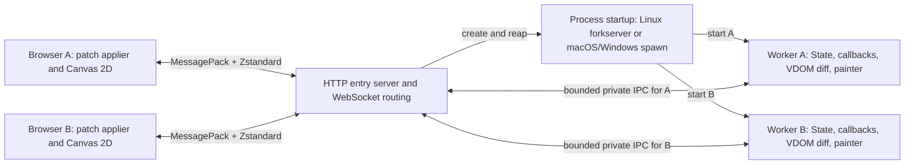

# Web backend plan and remaining work

Latest runtime audit: [2026-10-28 macOS validation](validation-2026-10-28.md).

Autocomplete follows the [shared acceptance criteria](https://buganini.github.io/PUI/doc/Reference.html#autocomplete-acceptance).

The Web cookbook runs with `make web` at
`http://localhost:8866/pui/`. This document tracks functional gaps and known issues; available
APIs are in the [common reference](https://buganini.github.io/PUI/doc/Reference.html), [Web reference](../PUI/doc/web-reference.md)
and [wire contract](../PUI/doc/web-api.md).
The current runtime serves a cookbook subset. Broader Windows and packaging validation,
the broader desktop widget API and cross-browser checks remain incomplete.

Implemented integrations are **complete**. This backlog tracks missing functionality,
known bugs and design decisions. Additional test coverage does not keep a feature
open. Detailed test environments, results and follow-up QA are in
[validation notes](validation-2026-10-30.md#web). Platform names below identify
known differences or specific bugs, not a mandatory three-OS completion matrix.

## Requested architecture

- Python runs on the server, builds the PUI VDOM from `content()` and State,
  and calculates render diffs against the client's acknowledged state.
- JavaScript applies patches with stable node IDs and base/target revisions.
  Full snapshots establish the initial tree or recover a desynchronized client;
  batch deduplication and ACKs make render retransmission safe.
- Application messages use MessagePack serialization and Zstandard compression.
- State bindings synchronize by the server-side `id(obj)` of their owning
  object, together with the bound attribute/key/index. Identity is scoped to the
  client session; Python remains authoritative for values and callbacks.
- Each client has a dedicated Python process (Linux forkserver; macOS/Windows
  spawn). That worker handles one client and processes its events serially;
  the HTTP entry server can serve many clients concurrently.
- Canvas painter calls execute in Python, producing drawing commands that the
  browser replays through Canvas 2D.

Transport: HTTP for the page and packaged static assets, with a binary
WebSocket for bidirectional application messages. One browser tab/connection
corresponds to one client. Each username (or anonymous browser owner) has at most
one worker; a new connection takes over the old one. Static asset requests do not create workers.
Public assets and WebSocket URLs are relative to the browser entry page.
The upstream `mount_path` controls routing independently; proxies rewrite cookie
paths when the upstream and public prefixes differ.

The gateway uses aiohttp and platform-specific standard-library multiprocessing
contexts. Linux uses `forkserver` with an empty preload list; macOS and Windows
use fresh interpreters through `spawn`. The diagram shows the gateway that owns
network connections and relays binary messages to workers. It does not require passing live HTTP/TLS
protocol objects across a fork. Worker application state stays private.

## Baseline and existing integration points

Source audit: `8074c0a8011e63c56063841ce0279a6cf91a981e` (2026-10-15).
Use this commit's shared core and PySide6 behavior as the initial reference;
record a newer component baseline only when intentionally adopting a change.

- [PUIView](../PUI/view.py) rebuilds declarations, tracks State subscriptions,
  and permits independent subview redraws. Its global view registry becomes
  worker-local through process isolation.
- [dom.sync](../PUI/dom.py) already reconciles Python node identity, retires old
  handles, manages virtual children, and invokes backend update/child hooks.
  Preserve these lifecycle rules; the Web hooks should maintain serializable
  render records rather than native widgets. Python diffs these records against
  the acknowledged render state; JavaScript applies the resulting operations.
- [PUINode](../PUI/node.py) keys are not globally unique: repeated unkeyed nodes
  are valid. Its `serialize()` produces diagnostic text, not a wire format.
  Assign separate session-local wire IDs and write an explicit schema.
- [TimelineView](../PUI/timeline.py) uses timer threads. Queue redraw requests
  onto the worker's application loop; never reconcile concurrently with an event.
- [State bindings](../PUI/state.py) recreate AttrBinding/ListBinding/DictBinding
  wrappers on each `state(key)` call. Identify their source with
  `id(binding.state)`, binding kind and key; [table editing](../PUI/_table.py)
  already uses that source identity to detect rebinding.
- Importing [PUI](../PUI/__init__.py) can start a jurigged watcher when installed.
  The forkserver uses an empty preload list, keeping application imports and
  watchers outside the supervisor. The cookbook gateway imports its launcher
  class; workers import and initialize their applications independently.
- [PySide6 Canvas](../PUI/PySide6/canvas.py) supplies the painter signatures;
  [the reference](https://buganini.github.io/PUI/doc/Reference.html#canvas) supplies logical-pixel, density, and
  event contracts. Native Qt quirks are findings to review, not wire semantics.

The shared framework retains Python 3.9 support. Select compatible Web
dependencies or discuss a backend-specific minimum; do not raise the shared
minimum. Standard-library `compression.zstd` was added in Python 3.14, so it
cannot be the only implementation for a Python 3.9 Web backend.
See [Python's Zstandard API](https://docs.python.org/3.14/library/compression.zstd.html).

## Lifecycle gaps

Administrative account-wide revocation, global auth-callback concurrency limits
and global login rate limits remain unimplemented. Expired authenticated owner
records need a bounded retention policy. Handshake connection limits and a
smaller hello decoding budget still need implementation.

## Prioritized implementation backlog

Rows below describe functional gaps and design decisions. Implemented
integrations are complete; additional QA is recorded in the validation notes.

| ID | Priority | Remaining work | Acceptance check / decision dependency |
| --- | --- | --- | --- |
| W11 | P1 | Table extensions | Column resizing, sorting, embedded widgets, virtualization and multi-selection remain additions. Existing Table, Tree, Modal and imperative function integrations are complete. |
| W13 | P2 | Markdown and additional window commands | Define browser semantics and dependency choices. File helpers and OpenURL are implemented and complete. |

Web uses one browser page per Application. Additional browser windows,
MDI-style views still need an explicit browser-specific contract. Open-file helpers now use device upload or webroot-confined server selection in one modal.
SaveFile now supports server browsing with `webroot` confinement and session-owned
download staging with session-owned attachment links. Dismissible notifications
show creation time and size refreshed every second; Chrome delivery and size-update
checks pass in both execution modes. Writer-completion detection is not provided. Chrome flows and
normal/passthru IPC tests cover cancellation, overwrite confirmation, directory
navigation, symlink escape rejection, disconnect and cleanup (2026-10-29). Direct
native-widget hierarchy embedding is outside the DOM backend contract. Fullscreen is subject to browser user-activation rules; maximize cannot
be promised as an OS-window operation. Window icons and fullscreen still need
implementation; their constructor options are accepted with warnings and ignored
so shared desktop declarations can run.

## Decisions before dependent implementation

- **D3 — Browser baseline:** Chrome is tested. Validate Firefox/Safari before
  claiming support. The approved build uses @msgpack/msgpack, compress-utils 0.10.1
  and esbuild; additional dependencies still require approval. Exercise
  the downstream streaming decoder and its malformed-batch fixtures on those
  engines; upstream events deliberately retain independent compressed frames.
- **D6 — Remaining browser mappings:** agree dialogs, files and desktop window
  behavior when reached. Any pixel-exact cross-backend image resampling or
  server-side pixel access would require a separate design.

## Implementation and validation process

Use Application/PUIView classes and explicit arguments for new public APIs.
Start with backend-local render records, public browser DOM/Canvas APIs and
existing shared bindings. Avoid monkey patches, hidden whole-DOM rebuilds and
new frameworks introduced solely to bypass lifecycle work.

For each completed implementation change, run focused checks, update
[common reference](https://buganini.github.io/PUI/doc/Reference.html), cookbook
availability and [Changelog.txt](../Changelog.txt) as applicable, then commit.
Remove completed rows from this backlog; keep missing/partial behavior, pending
decisions and known functional gaps. Move established contracts into the reference.
Do not add delivery/completion sections or temporary artifact paths.

Validation must include Python/JS protocol fixtures, real browser interaction,
two-worker isolation, lifecycle teardown and Canvas replay. Test immutable render
retries, lost/duplicate ACKs, wrong bases, partial application failure, snapshot
recovery and late/duplicate events. Check local typing ahead of server state,
empty patches confirming rejected edits, changing handlers,
recreated binding wrappers, shared bound slots, object ID reuse, registry cleanup,
list index shifts, dictionary slot recreation, reordered nodes, resize storms,
backpressure, malformed frames and disconnect during painting. Compare server
patch results against target records and Canvas commands deterministically,
and use browser pixels/geometry checks where
visual behavior matters. DOM mocks alone do not establish focus, IME, Canvas or
layout correctness.

Run existing shared lifecycle/State tests and `make check-python39` if shared
code changes. Keep Web runtime/browser checks separate from the existing Qt
baseline. Document the actually tested browsers and server versions; no broader backend support flags or performance guarantees before validation.

## Canvas / Matplotlib functional gaps

The shared adapter renders paths, glyph outlines, mathtext and RGBA images.
See [Canvas Functions](https://buganini.github.io/PUI/doc/Reference.html#canvas-functions) for the capability
matrix and native/no-op clipping behavior. Functional gaps: navigation UI/default shortcuts, hatch, Gouraud shading, cap/join/dash parity, large-image batching and
sustained redraw optimization.

Matplotlib mouse/key callbacks now use the shared input adapter. Web/Pyodide
handle focus, blur, pointer capture and connection resets; native browser input
and Python callback tests cover this path. Pan/zoom algorithms
work with Matplotlib NavigationToolbar2 in tests, but no PUI navigation UI or
wheel-zoom policy is installed automatically.
